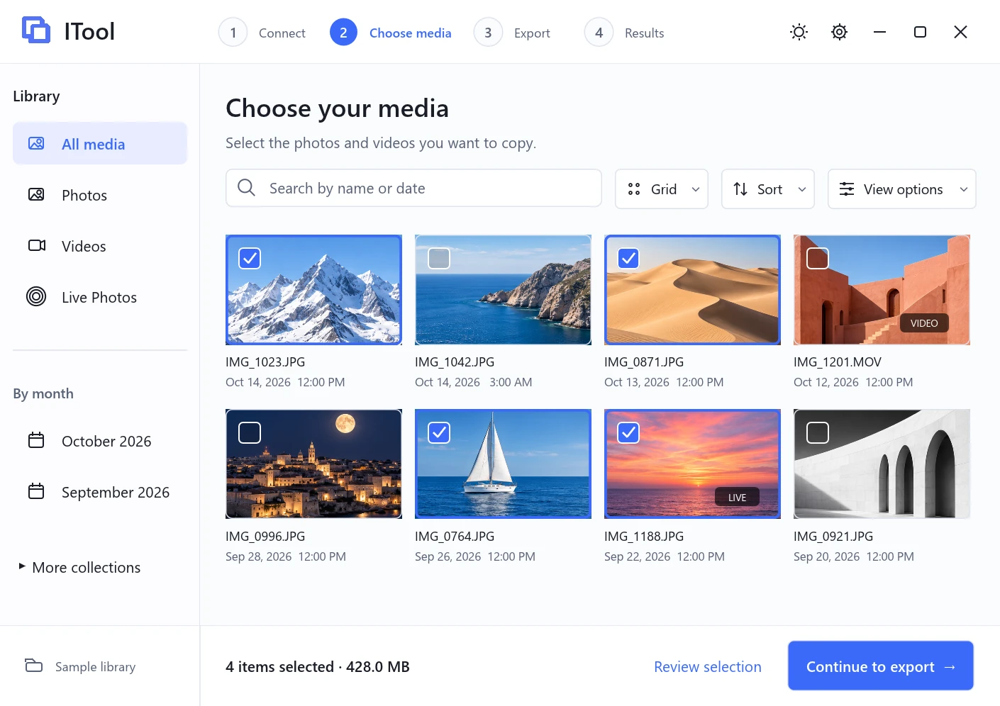
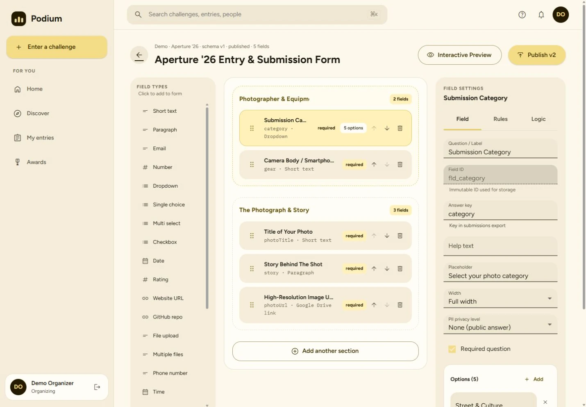
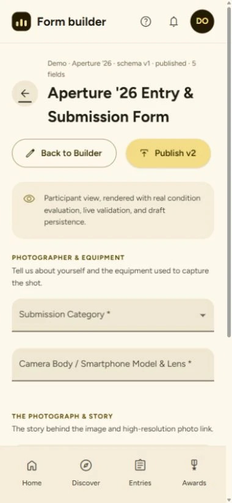

# Project image report · 27 October 2026

## Delivered assets

All **33 website assets are WebP**, totaling **2,314,414 bytes** (about 2.31 MB).
Source PNG/JPEG files are kept outside `public/`; the website asset directories
contain only WebP. No project entries or case-study pages have been published.

| Project | Count | Website directory | Evidence |
| --- | ---: | --- | --- |
| OpenSense | 8 | `public/projects/opensense/` | Fresh Android emulator captures at 1080 × 2400, 420 dpi, fontScale 1.0 |
| ITool | 8 | `public/projects/itool/` | Screenshots published in the project's README at `4e4c4838bec8f1dc51fb8323f7389c02a3a09a33` |
| Podium | 16 | `public/projects/podium/` | Local browser captures: 9 desktop and 7 mobile |
| Pineapple Music | 1 | `public/projects/pineapple-music/` | AI-generated yellow fruit cover, not an app screenshot |

Dimensions, file sizes, SHA-256 digests and source classifications are recorded
in [the manifest](../assets/project-captures/2026-10-27/manifest.json).
The [conversion script](../assets/project-captures/2026-10-27/prepare-images.mjs)
uses Sharp WebP quality 90, effort 6. It rejects any OpenSense source that is not
1080 × 2400. The compact 840 × 1680 / 130% text capture was excluded entirely.

## OpenSense — verified capture and push

Built the app and instrumentation APKs from app source `6cc73d5`. Ran the
existing `UiCaptureTest.captureSupportedSurfaces` on the `OpenSenseUI` emulator:
**OK (1 test)** at normal resolution and text size. The compact run also passed,
but none of its images is included. This is UI capture evidence, not a fresh
full test-suite run or proof of vehicle compatibility.

Selected images: offline dashboard, simulated dashboard, climate, media,
insights, settings, light dashboard and light climate. Simulated data and demo
playback labels remain visible. No physical vehicle was connected.

The eight WebP files and README documentation were committed and pushed to
`Marshmellow31/OpenSense`, `main`, at
`c7e7b6ea6161c7907cd393d75f417ade1415acae`. No PR or merge was needed.
The published screenshot documentation was read back through GitHub.
Unrelated untracked model assets/tools were excluded from the commit.

[Published screenshot gallery](https://github.com/Marshmellow31/OpenSense/tree/main/docs/screenshots/2026-10-27)

## ITool — verified README screenshots

The updated README contains Connect, Choose media, Export and Results in both
light and dark themes. All eight published PNG sources were converted from the
matching local checkout at commit `4e4c4838bec8f1dc51fb8323f7389c02a3a09a33`.
The source repository was not edited by this task.

These are actual app captures using a synthetic sample library. Results counts,
rates and export outcomes are simulated. They must not be described as measured
USB transfer performance or a completed physical-iPhone export.

## Podium — verified local screenshots

Desktop viewport: 1440 × 1000. Mobile viewport: 390 × 844. Captured bitmap
dimensions vary slightly with scrollbar exclusion and full-page capture; the
manifest records the exact saved dimensions. Mobile full-page captures include
the complete onboarding/challenge pages, rather than only the first viewport.

Captured landing, participant/organizer onboarding, discovery, public challenge,
organization dashboard, challenge control room, form builder and interactive
form preview. Selected pages were visually inspected; the mobile builder and
preview had no document-width overflow in the inspected 390-pixel viewport.
This was a screenshot walkthrough, not a production-readiness assessment.

The populated screens use a **local-only Firebase Auth and Firestore emulator**
project, `demo-podium-portfolio`. The organization is explicitly named
`Portfolio Demo Institute`; the competition title includes `Demo`; participant
names and `example.test` addresses are fictional. No hosted data was seeded or
modified. No schema, results or awards were published.

The existing photography fixture was reused. Its rubric percentages were
normalized to fractional weights in the local seed data to match the app's
current display contract. No application source was changed for that adjustment.
The reproducible [local seed utility](../assets/project-captures/2026-10-27/seed-podium-demo.cjs)
forces localhost emulator endpoints and the demo project ID.

### Findings to refine later — needs confirmation beyond this walkthrough

- Some client-side route transitions retained overlapping old/new page layers in
  this browser session. Reloading the route cleared them. The selected builder
  and preview images were recaptured from a clean instance. Root cause is not
  established; browser rendering may contribute.
- Organization dashboard growth badges show `+12` and `+8` alongside the seeded
  counts of three. These must not be presented as real usage or measured growth.
- The Judging tab displayed sample judge progress/strategy values that did not
  match this small local fixture. That tab was not selected for the image set.
- A 390-pixel mobile form builder stacks its palette ahead of the editable form,
  requiring substantial scrolling. An interactive preview capture is available
  as a clearer mobile illustration. This is a design observation, not a fix.

Podium remains on `main` at `4d6274c8` with its pre-existing uncommitted changes
preserved. This task created no Podium commit, push, PR or deployment.

## Pineapple Music — generated artwork

Built-in imagegen tool, with no reference images. Final cover:
`public/projects/pineapple-music/yellow-fruit-cover.webp` (1672 × 941).
The original generated PNG is retained with the capture sources.

Prompt: “Use case: stylized-concept. Asset type: playful portfolio project cover
for Pineapple Music. A whole golden pineapple with a sculptural green crown standing beside
a freshly cut apple, two apple halves with visible seeds and cream flesh. Rich
sunny yellow seamless background and yellow tabletop, warm yellow aesthetic,
playful polished studio still life with tactile realistic fruit, soft directional
shadows. Wide landscape composition, both fruits centered with generous breathing
room for responsive cropping. No text, no logos, no UI, no watermark. Just the
pineapple and cut apple. Cheerful, slightly surreal, beautifully art directed.”

This artwork is an illustrative project cover. It makes no claim about working
Apple Music account access, subscription playback or project completion.

## Portfolio publication state

Prepared on portfolio branch `main` from base commit `3470a27`. The user reviewed
the local preview and subsequently authorized pushing to `main`. Final commit,
push and deployment evidence belongs in the release handoff.
The subsequent local integration adds Podium under Products and ITool, OpenSense
and Pineapple Music under Hobby & Experiments, with individual detail pages and
home-sphere entries. Status badges and image provenance remain visible. All new public image files
were decoded and checked to be real WebP; the eight OpenSense copies were checked
against the source repository copies. The unrelated existing portfolio image
formats are outside this asset-preparation task.

## Local website verification

- Preview: http://127.0.0.1:5173/projects (Vite development server).
- Production build and SEO guard passed: 32 routes, including all four new detail pages.
- Project routes are unique; every new referenced source image exists and uses WebP.
- Responsive gallery variants generated in WebP by the existing build pipeline.
- Project index and four detail pages inspected at 1440 × 1000 and 390 × 844.
  No horizontal document overflow observed; mobile status labels adjusted to wrap cleanly.
- Browser error log was empty for the inspected preview session.
- Lint completed with warnings in the existing doodleshooter game; the changed
  files produced no lint warnings. Build retains the existing large-chunk warning.
- These checks establish local behavior. Deployment and search indexing require separate verification.
